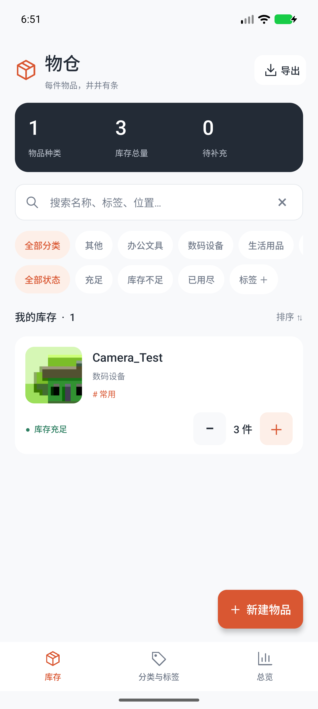
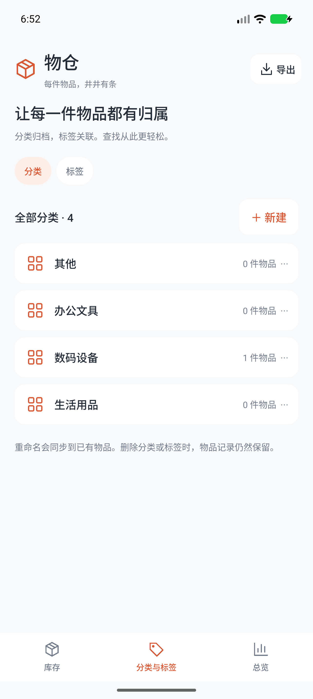
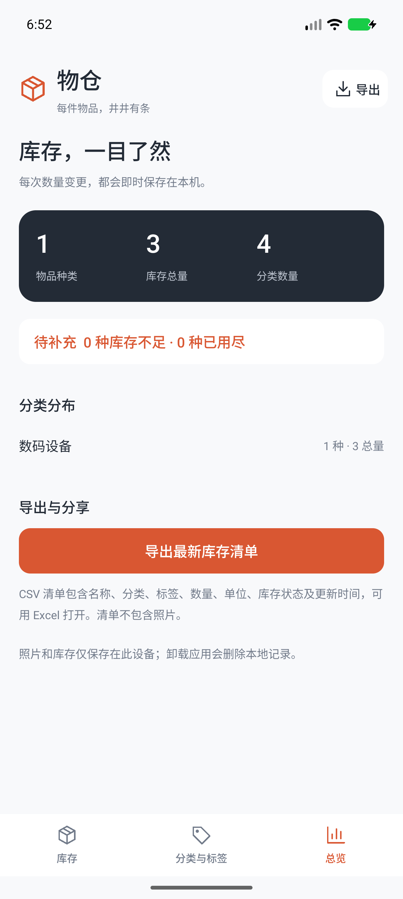

# 物仓 · 安卓物品仓库

一个离线使用的原生安卓应用：拍照记录物品，以分类和标签整理库存，随时查看数量并导出最新清单。

- 拍照或相册入库，记录名称、数量、单位、存放位置与备注。
- 自定义分类和多标签，支持组合检索、排序和库存状态筛选。
- 一键增减库存，设置低库存阈值，查看库存总览。
- 导出全部或筛选后的中文 CSV，通过系统文件选择器保存或分享。

## 界面

| 库存首页 | 分类管理 | 库存总览 |
| --- | --- | --- |
|  |  |  |

截图为 Android 模拟器中的实际运行界面，`Camera_Test` 是验收样例。

## 安装

从 [GitHub Releases](https://github.com/TheOldZhan/wucang-android/releases/latest) 下载 APK、源码 ZIP 和 `SHA256SUMS.txt`。

本地构建后的安装包位于 `artifacts/WuCang-1.0.0-debug.apk`。

将 APK 发送到安卓手机，打开文件后按系统提示允许该来源安装。最低支持 Android 8.0（API 26）。当前为使用调试证书签名的可安装测试版本；应用商店发布需要另行设置正式签名。

应用首次打开为空库存，没有演示物品；预置少量可修改的分类和标签。

## 使用

1. 在「库存」点击「新建物品」，拍照或从系统相册选择照片，填写名称、分类、数量和单位后保存。照片也可以暂不添加。
2. 设置低库存提醒阈值。数量大于阈值显示「库存充足」，大于零但不高于阈值显示「库存不足」，为零显示「已用尽」。此提醒是应用内状态标识，不是后台推送。
3. 通过搜索框检索名称、分类、标签、存放位置及备注。分类、状态和多个标签可以组合筛选；多标签筛选表示同时包含所有选中的标签。
4. 点物品图片或名称进入编辑；点击 `−` / `＋` 即时调整数量，点击数量可直接输入。数量只接受 0～999999999 的整数。
5. 在「分类与标签」新增、改名或删除整理项。删除分类会把相关物品移至未分类；删除标签仅解除关联，均不会删除物品记录。
6. 点击右上角「导出」，选择全部库存或当前筛选结果，再选择保存 CSV 或通过系统分享面板发送。

「总览」显示种类、总数量、待补充情况和分类分布。总数量是各物品数量的简单合计，不做不同单位之间的换算。

## 数据与导出

- 使用本机 SQLite 保存库存，无需账号或服务器；应用没有网络权限。
- 调用系统相机或系统文件选择器，应用不申请广泛的存储访问权限。
- 照片导入后复制至应用私有目录，校正 EXIF 方向，最长边缩小至 1600 像素并以 JPEG 保存。删除相册中的原图不会影响已入库照片。
- CSV 使用 UTF-8 BOM，便于 Excel 识别中文；包含名称、分类、标签、数量、单位、阈值、库存状态、位置、备注以及创建、更新和导出时间。
- 每次导出使用发起操作时的最新库存快照；CSV 正确处理逗号、引号、换行，并对可能被电子表格识别为公式的文本加保护前缀。
- CSV 不内嵌照片，也不是完整应用备份。当前不提供 CSV 导入、云同步、自动图像分类或货币估值。
- 卸载应用或清除应用数据会删除本地记录和应用内照片。系统自动云备份已关闭；重要库存请定期导出清单。

## 开发与构建

原生 Java + Android Views + SQLite。使用 AndroidX Core 提供 `FileProvider`，使用 AndroidX ExifInterface 校正照片方向，无 WebView。

开发环境：JDK 21、Android SDK 36.1、Build Tools 36.0.0、Android Gradle Plugin 9.2.0、Gradle 9.4.1。应用目标 SDK 为 35，最低 SDK 为 26。

在 Android Studio 中打开本文件夹，安装对应 SDK 后同步。也可在 PowerShell 执行：

```powershell
git clone https://github.com/TheOldZhan/wucang-android.git
Set-Location wucang-android
.\build.ps1
# 已有缓存时：
.\build.ps1 -Offline
# 静态检查：
.\build.ps1 -Offline -Tasks lintDebug
```

构建脚本优先使用有效的 `JAVA_HOME`，否则寻找本机 JDK；根据 `ANDROID_HOME` / `ANDROID_SDK_ROOT` 或常规 SDK 路径创建 `local.properties`。首次构建需要下载 Gradle 和 Maven 依赖，后续可离线构建。

macOS / Linux 可设置 `JAVA_HOME` 和 `ANDROID_HOME` 后使用 `./gradlew assembleDebug`。如果未通过 Android Studio 配置 SDK，请在本地 `local.properties` 中设置 `sdk.dir`。构建输出为 `app/build/outputs/apk/debug/app-debug.apk`。

```text
app/src/main/java/com/wucang/inventory/
  MainActivity.java        库存、搜索筛选、管理、总览与清单导出
  ItemEditorActivity.java  物品编辑、相机与相册流程
  Ui.java                  界面样式和图标
  data/                    模型、SQLite、筛选、CSV
  io/                      私有照片与可分享文件
app/src/androidTest/       设备上的数据库、照片及交互回归测试
artifacts/                 APK、构建和验证结果
docs/                     验证记录与截图
```

## 验证

设备测试使用平台 `android.test.InstrumentationTestRunner`，无需联网服务。安装主 APK 和测试 APK 后：

```powershell
adb install -r app\build\outputs\apk\debug\app-debug.apk
adb install -r app\build\outputs\apk\androidTest\debug\app-debug-androidTest.apk
adb shell am instrument -w com.wucang.inventory.test/android.test.InstrumentationTestRunner
```

本次构建、设备验证结果与仍需真实手机确认的项目见 [`docs/VERIFICATION.md`](docs/VERIFICATION.md)。

Android 官方参考：[应用构建版本兼容性](https://developer.android.com/build/releases/about-agp)、[系统文件创建与选择](https://developer.android.com/training/data-storage/shared/documents-files)。

## 许可证

本项目原创代码采用 [MIT License](LICENSE)，可以在遵守许可证的前提下使用、修改和再分发。

第三方依赖与 Gradle Wrapper 保留各自的许可证，见 [第三方声明](THIRD_PARTY_NOTICES.md)。许可文本随源码提供，并包含在 APK 的 `assets/licenses/` 中。
